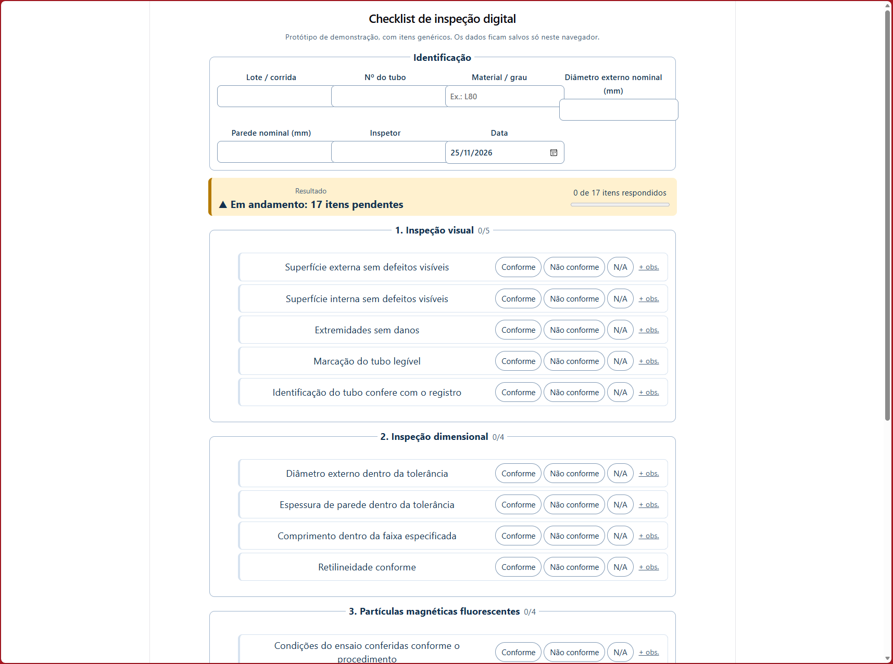

# Checklist de inspeção digital

Checklist de inspeção por etapas, com resultado automático, apontamento de recorte com cálculo de massa e relatório para imprimir ou salvar em PDF.



**Demo:** _(https://checklist-inspecao-digital-hazel.vercel.app/)_

## Por que criei

Trabalho com inspeção dimensional e visual de tubos de aço sem costura. O registro de uma inspeção segue um roteiro e, quando há um defeito, é preciso apontar quanto do tubo será cortado. Criei este checklist para registrar tudo em um só lugar e gerar um relatório. Também faz parte dos meus estudos de desenvolvimento web com React.

## O que ele faz

- Checklist dividido em etapas, com aprovado, reprovado ou não se aplica.
- Resultado geral calculado automaticamente.
- Apontamento de recorte: comprimento removido, comprimento restante e massa correspondente.
- Relatório em página própria, pronto para imprimir ou salvar em PDF.

## Tecnologias

React, Vite, JavaScript, CSS.

## Como rodar

Requisito: [Node.js](https://nodejs.org) 18 ou superior.

```bash
git clone https://github.com/seu-usuario/checklist-inspecao
cd checklist-inspecao
npm install
npm run dev
```

Abra o endereço que aparecer no terminal (normalmente http://localhost:5173).
Sem o Git, baixe o ZIP pelo botão verde **Code** desta página.

## Observações

- Os **itens do checklist são genéricos e fictícios**. Não representam nenhuma norma, cliente ou procedimento de empresa.
- O cálculo de massa usa a geometria nominal do tubo e a densidade informada (massa teórica).
- Ferramenta de estudo e demonstração, não substitui o registro oficial de inspeção.

## Autor

Negoedd · [LinkedIn](https://www.linkedin.com/in/edson-nunes)
